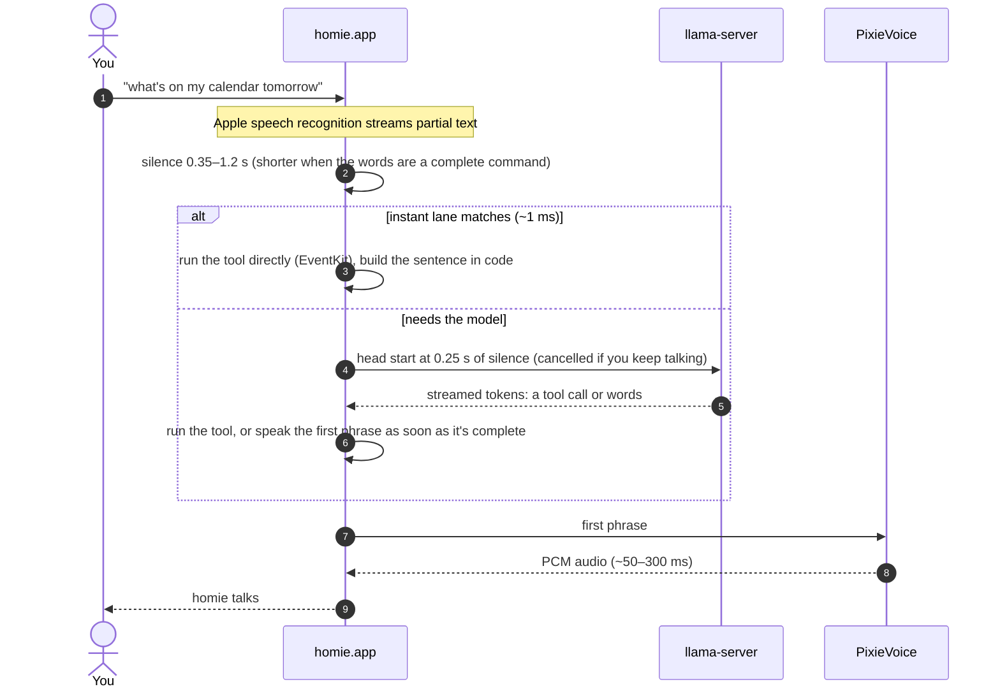

# How homie works

Three local processes, all on your Mac:

| Process | What | Talks over |
|---|---|---|
| **homie.app** | Notch UI, speech recognition (Apple, on-device), the instant lane, tools, memory | — |
| **llama-server** | Qwen 3.5 4B (or 2B on 8 GB Macs) on the GPU via Metal | HTTP on 127.0.0.1, random API key per launch |
| **PixieVoice** | Kokoro-82M text-to-speech on the Neural Engine | HTTP on 127.0.0.1, random API key per launch |

Both engines ship inside the app (`Contents/Helpers/homie`). Only the model weights download on first launch, from a pinned Hugging Face commit checked against its SHA-256.

## One voice turn

## Keeping the brain warm

The prompt (persona + ~30 tool descriptions) is about 3,300 tokens: 7–19 s to read on a laptop. homie reads it once:

1. On first launch the prompt is rendered with llama.cpp's chat template and read **up to the user-turn marker** (`<|im_start|>`), then the model state is saved to disk (`/slots/0?action=save`).
2. Later launches restore that file in ~0.12 s. A question then only adds its own tokens (~45).
3. Every request uses **sorted JSON keys**. Swift dictionaries iterate in a different order on each launch, so without sorting, the tool list renders differently and nothing in the cache matches. That cost a full re-read after every relaunch until we found it.
4. Qwen 3.5 is a hybrid (attention + recurrent) model, so it can't rewind to an arbitrary position, only to saved checkpoints. That's why the saved state must end exactly where questions begin, and why the first question after a restore skips the head start.

## The instant lane

`LocalRouter.intent(_:)` maps normalized speech to a tool call or a spoken answer. Rules:

- Anything with "and", "then" or "after" goes to the model (multi-step).
- Every pattern has must-not-fire tests (`Tests/LocalRouterTests.swift`) and lives in the coverage sets (`Tests/local_eval/coverage*.tsv`).
- If the tool result isn't a clear success, the model gets the result and explains, so homie never claims something worked when it didn't.

## Memory

`LocalMemory` learns from phrasing ("I hate olives", "my dog's name is Mochi", "remember that…"), from usage (artists, apps), from when you talk to it (coarse: "weekday evenings"), and from a look-back after each conversation, where the local model lists lasting facts in 0.2–0.7 s. The card enters the prompt only between conversations, so it never invalidates the cache mid-chat.

## Seeing the screen

Hold <kbd>fn</kbd> and circle something. `ScreenPeek` crops the circled area from a screenshot (ScreenCaptureKit), runs Apple's on-device text recognition and image classification, and hands the result to the model as text. No image leaves the Mac and no extra model sits in memory.
